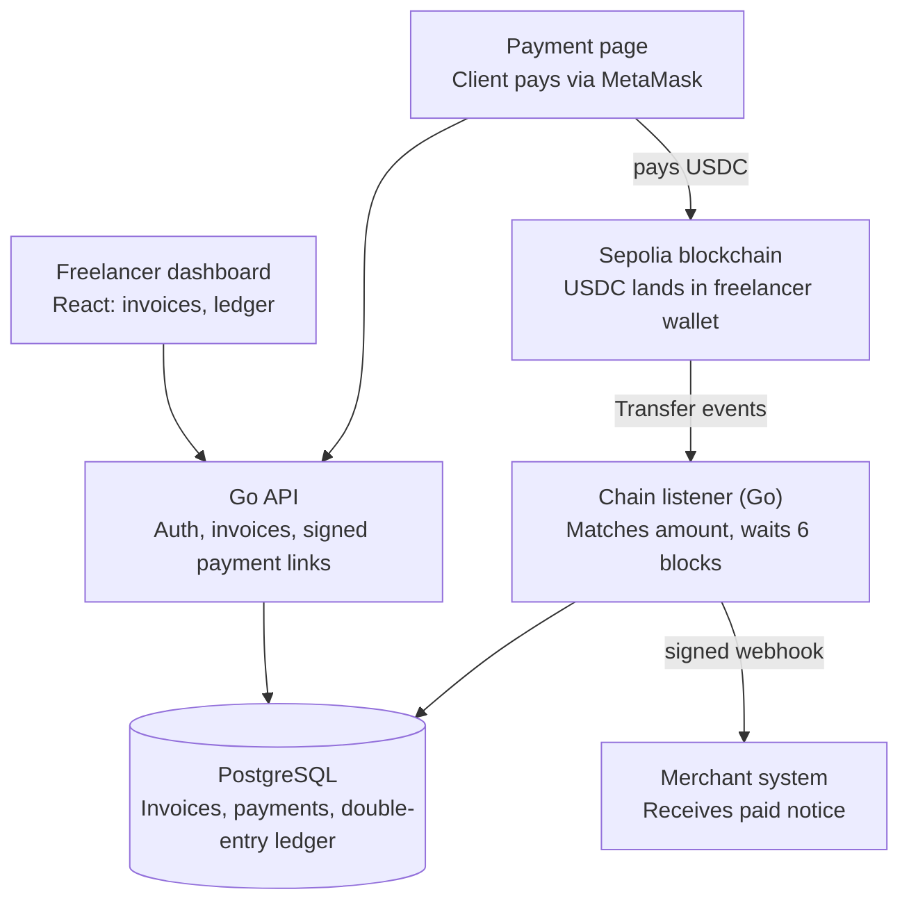
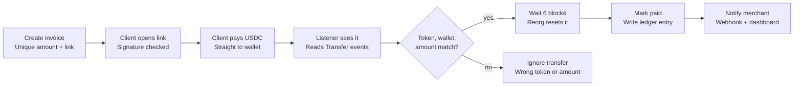

# Ledgerline — Stablecoin Payment Gateway

> **Testnet only.** This is a demo on Ethereum Sepolia with testnet USDC. No real money.

Project plan · Nov 10, 2026 · @Vahe · [PDF version](docs/project-plan.pdf)

## 1. Product brief

We build a non-custodial tool that lets freelancers invoice clients abroad and
get paid in USDC within minutes, live on testnet by **Nov 26, 2026**.

**Problem.** Freelancers in many countries (Armenia included) can't use Stripe
or PayPal fully. International bank transfers take days and cost 3–7% in fees
and FX spread.

**Users.**

- **Freelancer (merchant):** creates invoices, shares links, tracks what was paid.
- **Client (payer):** opens a link, pays with a crypto wallet.

**Solution.** The freelancer creates an invoice and sends a link. The client
pays USDC straight to the freelancer's own wallet. We detect the payment
on-chain, mark the invoice paid, and record it in a double-entry ledger.

**In scope (v1).**

- Sign up, log in, save wallet address
- Create, list and view invoices
- Public payment page with MetaMask payment
- On-chain payment detection with confirmations
- Double-entry ledger and reconciliation view
- Webhook to notify the merchant's system

**Out of scope (v1).** Real money, mainnet, other tokens or chains, refunds,
fiat conversion, teams, mobile app, KYC.

**Success metrics.**

| Metric | Target |
| --- | --- |
| End-to-end test payment detected | under 2 minutes |
| Ledger balanced (debits = credits) | 100% of entries, enforced by test |
| Demo flow passes | 10 runs in a row without failure |
| Live public demo | 1 URL anyone can open |

## 2. System parts

The product has seven parts; only two (dashboard and payment page) are seen by
users. Money goes on-chain to the freelancer; our system only watches and
records.



The client's USDC goes straight to the freelancer's wallet. The listener only
reads the chain, then writes to the ledger and notifies the merchant.

## 3. Payment flow

An invoice becomes paid only when the right token, wallet and exact amount
arrive and survive 6 confirmations.



Anything that fails the check is ignored, so fake tokens or wrong amounts never
mark an invoice paid.

## 4. Technical design

The system never holds funds: it watches the chain, matches transfers to
invoices, and records them in a balanced ledger.

**Stack.** Go (API + chain listener), PostgreSQL, React + TypeScript (Vite),
go-ethereum, Docker, GitHub Actions. Network: Ethereum Sepolia, token: testnet
USDC.

**Invoice matching.** All payments land in the same freelancer wallet, so each
invoice gets a unique amount. A $100 invoice becomes 100.000417 USDC; the extra
6-decimal suffix identifies the invoice. The listener matches a transfer only
if token contract, recipient wallet and exact amount all agree.

**Confirmations.** A payment moves `detected → confirmed` after 6 blocks. If a
reorg drops the transaction before that, it goes back to `pending`.

**Data model.**

| Table | Key columns |
| --- | --- |
| `users` | id, email, password_hash, wallet_address, created_at |
| `invoices` | id, user_id, client_name, amount, unique_amount, status, due_date, link_signature |
| `payments` | id, invoice_id, tx_hash (unique), block_number, confirmations, status |
| `ledger_entries` | id, transaction_id, account, debit, credit, created_at |
| `webhook_deliveries` | id, invoice_id, url, attempt, status, next_retry_at |

All money is stored as integer units (USDC has 6 decimals: `1 USDC = 1_000_000`),
never as floats.

**Accounting entries.**

| Event | Debit | Credit |
| --- | --- | --- |
| Invoice issued | Accounts Receivable | Revenue |
| Payment confirmed | USDC Wallet | Accounts Receivable |
| Invoice voided | Revenue | Accounts Receivable |

Every ledger transaction must balance: a database check and a test reject any
entry where debits ≠ credits.

**Reconciliation.** A daily job compares the ledger's USDC Wallet balance with
on-chain transfers to the wallet and flags any difference.

**Security.**

- Non-custodial: no private keys stored, funds go straight to the freelancer
- Payment links signed (HMAC) so the amount or address can't be swapped
- Exact token contract check, so fake copycat tokens are ignored
- Idempotency: `tx_hash` is unique, so one payment can't be recorded twice
- Webhooks signed so merchants can verify they came from us
- Passwords hashed (bcrypt), secrets only in environment variables

## 5. Decision records (ADRs)

Each decision becomes a short file in `docs/adr/`.

| # | Decision | Why | Trade-off |
| --- | --- | --- | --- |
| 001 | Non-custodial: never hold funds or keys | Removes the biggest hack and legal risk | No escrow or refunds by us |
| 002 | Unique amount per invoice for matching | Works with one wallet, no smart contract | Client pays a tiny fraction extra |
| 003 | Go for API and listener | Fast, strong concurrency, matches past fintech work | More code than Node for simple CRUD |
| 004 | PostgreSQL with double-entry ledger | ACID transactions, balance checks in DB | Stricter schema work up front |
| 005 | Sepolia testnet only for v1 | No real money risk during demo | Not a production product yet |
| 006 | Integer money units, no floats | Floats cause rounding errors in finance | Must convert for display |

## 6. Stages and timeline

Eight stages run Nov 11–22, with Nov 23–26 kept as buffer; the hard gate is a
working end-to-end payment by **Nov 15**. Build plan: about 2 to 3 hours a day.

| Stage | Dates (2026) |
| --- | --- |
| 1. Plan and design | Nov 11 |
| 2. Invoices + ledger | Nov 12 to Nov 13 |
| 3. Payment detection | Nov 14 to Nov 15 |
| **Gate: payment end to end** | **Nov 15** |
| 4. Interface | Nov 16 to Nov 17 |
| 5. Security | Nov 18 |
| 6. Deployment | Nov 19 |
| 7. Testing | Nov 20 |
| 8. Presentation | Nov 21 to Nov 22 |
| Buffer + fixes | Nov 23 to Nov 26 |
| **Launch on LinkedIn** | **Nov 26** |

If the gate slips, we use the cut list (section 9) rather than move the launch.

| Stage | Roles | Tasks | You get |
| --- | --- | --- | --- |
| 1. Plan and design | Product manager, architect | Freeze scope, write PRD and ADRs, set up repo and board | Repo, docs, ticket board |
| 2. Invoices + ledger | Backend dev, financier | DB schema, invoice API, ledger with balance check, unit tests | Invoices created, ledger always balanced |
| 3. Payment detection | Blockchain engineer | Listener on Sepolia, amount matching, 6-block confirmations, reorg handling | Test payment marks invoice paid |
| 4. Interface | Frontend dev, designer | Dashboard, invoice form, payment page with MetaMask | Usable product in the browser |
| 5. Security | Security engineer | Signed links, login, input validation, signed webhooks | Threat list closed in README |
| 6. Deployment | DevOps | Docker, CI pipeline, hosting, env secrets, logging | Live public URL |
| 7. Testing | QA tester | Full flow 10×, edge cases, bug fixes | Stable demo |
| 8. Presentation | Technical writer, marketer | README, diagram, demo video, LinkedIn post, CV line | Ready to share |

## 7. Process

We work like a small company team: tickets, branches, reviews, automated tests.

- **Backlog:** GitHub Projects board with columns To do / In progress / Review / Done. Every task is an issue.
- **Sprints:** Sprint 1 (Nov 11–15) builds the core; Sprint 2 (Nov 16–22) finishes product and deploys; launch Nov 23–26.
- **Daily check-in:** 5 minutes each session: what's done, what's next, what's blocked.
- **Git flow:** `main` is always deployable. One branch per ticket (`feat/ledger`, `fix/reorg`), merged by pull request.
- **Commits:** Conventional Commits (`feat:`, `fix:`, `test:`, `docs:`).
- **CI:** GitHub Actions runs lint, Go tests and frontend build on every pull request.
- **Environments:** local (Docker Compose) → production (live demo).

**Definition of done.** A ticket is done when it is coded, has tests for money
logic, passes CI, is merged to `main`, and is noted in the changelog.

## 8. Launch checklist

Nothing ships until every box is ticked.

- [ ] All CI checks green on `main`
- [ ] Full demo flow passes 10 times in a row
- [ ] No secrets in the repo (scan done)
- [ ] Health check and error logging live in production
- [ ] README: problem, demo link, architecture diagram, setup steps, ADR links, "testnet only" note
- [ ] 2-minute demo video recorded
- [ ] LinkedIn post written (problem → solution → architecture → lessons)
- [ ] CV entry added: one line on impact + stack
- [ ] Retrospective written: what went well, what to improve

## 9. Risks and cut list

If the end-to-end payment isn't working by Nov 15, we cut features from the cut
list instead of moving the deadline.

| Risk | Likelihood | Fallback |
| --- | --- | --- |
| Not enough hours (2–3 h/day needed) | High | Use the cut list |
| Sepolia RPC slow or rate-limited | Medium | Switch provider (Alchemy ↔ Infura), poll instead of subscribe |
| No testnet USDC available | Low | Deploy our own test ERC-20 token |
| Deployment issues | Medium | Deploy on day 9, leaving 3 days buffer |
| Scope creep | High | Scope frozen in section 1; new ideas go to a "v2" list |

**Cut list** (cut from the top first):

1. Reconciliation job (show manual check instead)
2. Webhooks with retries (keep simple single send)
3. Invoice voiding
4. Login with sessions (use a single demo merchant)

---

## Setup

### Repository layout

| Path | What it is |
| --- | --- |
| `cmd/api` | HTTP API (Go) |
| `cmd/listener` | Watches Sepolia for USDC payments (Go) |
| `internal/ledger` | Double-entry accounting rules |
| `migrations` | PostgreSQL schema |
| `web` | React + TypeScript frontend |
| `docs` | Project plan PDF and ADRs |

### Run everything with Docker

```sh
docker compose up --build
curl http://localhost:8080/healthz
```

If port 5432 is already in use on your machine, copy `.env.example` to `.env`
and change `DB_PORT`.

The migrations run only when the database is first created. After changing a
migration, reset the database with `docker compose down -v`.

### Run without Docker

```sh
go run ./cmd/api        # API on http://localhost:8080
go run ./cmd/listener   # listener (heartbeat only for now)

cd web
npm install
npm run dev             # frontend on http://localhost:5173
```

### Before finishing any change

```sh
gofmt -l .      # should print nothing
go vet ./...
go test ./...
```
